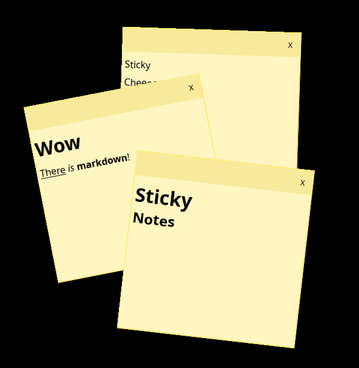
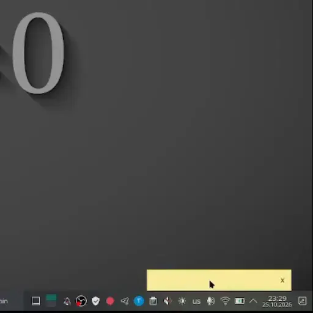
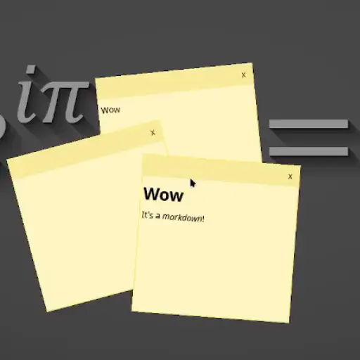

# StickyNotes

A small desktop application for creating sticky notes on Linux. Notes can be moved, resized, edited, and are saved locally.

<p align="center">
  
</p>

## Screenshots

<p align="center">
  
  &nbsp;&nbsp;&nbsp;&nbsp;
  <br>
  <sub>Creating &nbsp;&nbsp;|&nbsp;&nbsp; Markdown</sub>
</p>

<p align="center">
  
  &nbsp;&nbsp;&nbsp;&nbsp;
  <br>
  <sub>Stacking &nbsp;&nbsp;|&nbsp;&nbsp; Colors</sub>
</p>

# Installation

## Linux

### Requirements

- Linux with X11/XCB. On Wayland the application runs through XWayland.
- CMake 3.25 or newer
- C++17 compiler
- Qt 6 with Core, Gui, Widgets, and Quick
- X11 and XCB development libraries
- pkg-config

### Debian / Ubuntu

```bash
sudo apt update
sudo apt install build-essential cmake pkg-config qt6-base-dev qt6-declarative-dev libx11-dev libxcb1-dev
```

### Arch Linux

```bash
sudo pacman -S --needed base-devel cmake pkgconf qt6-base qt6-declarative libx11 libxcb
```

### Fedora

```bash
sudo dnf install cmake gcc-c++ pkgconf-pkg-config qt6-qtbase-devel qt6-qtdeclarative-devel libX11-devel libxcb-devel
```

## Build

```bash
git clone https://github.com/DartCat25/StickyNotes.git
cd StickyNotes
cmake -S . -B build
cmake --build build -j"$(nproc)"
```

### Run

```bash
./build/StickyNotes
```

Sticker data is stored in `~/.local/share/StickyNotes/stickers`.

## Windows

### Requirements

- Windows 10 (1809 or later) or Windows 11, x64
- Visual Studio 2022 Build Tools, workload **Desktop development with C++**
- Qt 6.12.0, **MSVC 2022 64-bit** (Core, Gui, Widgets)
- CMake 4.4.4

## Install

### Visual Studio 2022 Build Tools

Download **Build Tools for Visual Studio 2022** from
<https://visualstudio.microsoft.com/downloads/> and install the
*Desktop development with C++* workload (MSVC v143 compiler and a Windows SDK).

### Qt 6.12.0

Run the **Qt Online Installer** from <https://www.qt.io/download-qt-installer> and
select version `6.12.0` with the `MSVC 2022 64-bit` kit. The default installation
path is `C:\Qt\6.12.0\msvc2022_64`.

### CMake 4.4.4

Download the Windows x64 package from <https://cmake.org/download/> and install it,
so that `cmake` is available in the command line.

## Build

```bat
cmake -S . -B build -G "Visual Studio 17 2022" -A x64 ^
  -DCMAKE_PREFIX_PATH=C:/Qt/6.12.0/msvc2022_64

cmake --build build --config Release
```

`CMAKE_PREFIX_PATH` must point at the Qt kit directory, the one containing
`lib/cmake/Qt6`. The executable is produced at `build\Release\StickyNotes.exe`.

## Run

Qt is linked dynamically, so the Qt DLLs and the `platforms` plugin have to be
next to the executable:

```bat
mkdir build\dist
copy build\Release\StickyNotes.exe build\dist
C:\Qt\6.12.0\msvc2022_64\bin\windeployqt.exe --release --dir build\dist build\dist\StickyNotes.exe
```

The resulting `build\dist` folder is self-contained and can be copied to another
machine as is. For a quick run from the build tree it is enough to add the Qt
`bin` directory to `PATH`.

## IDE

Qt Creator: open `CMakeLists.txt` and select the `MSVC 2022 64-bit` kit.

Visual Studio: open the folder as a CMake project, or open the generated
`build\StickyNotes.sln`. For debugging, add `C:\Qt\6.12.0\msvc2022_64\bin` to the
debugging environment.

Visual Studio Code: install the *C/C++* and *CMake Tools* extensions and point
CMake Tools at the Qt kit via `CMAKE_PREFIX_PATH`. Debugging uses the `cppvsdbg`
debugger.

Sticker data is stored in `%LOCALAPPDATA%\StickyNotes\stickers`.
